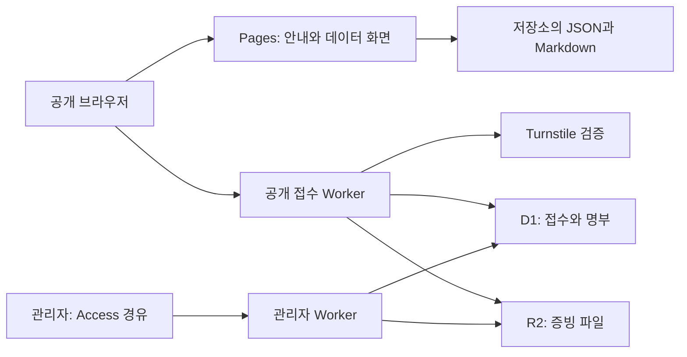

# 분당민주크루 웹사이트

커뮤니티 안내, 참여 신청, 분당 지역 선거결과와 전당대회 분석을 제공하는 웹사이트입니다. 공개 화면은 정적 파일로 배포하고, 확인자료 접수와 명부 관리는 별도 Cloudflare Workers로 처리합니다.

## 해결하려는 문제

참여 안내와 운영 문서, 지역 선거 자료를 한곳에서 찾을 수 있도록 구성했습니다. 선거 자료는 연도·선거·행정동을 선택해 지도와 표를 함께 읽을 수 있게 하고, 참여 신청은 공개 접수와 관리자 확인 절차를 분리했습니다.

## 주요 기능

- 홈에서 운영규칙·참여 신청·데이터 화면으로 이동
- Markdown 운영 문서와 외부 공개 기고문 열람
- 선거 타임라인, 선거별 전환, 행정동 SVG 지도와 상세 표 연동
- 전당대회 최종 결과·지역별 공개 자료·선호투표 관련 분석 표시
- 신규 참여·재확인 신청 유형에 따른 폼, 증빙 업로드, Turnstile 확인
- 별도 관리자 Worker의 신청 검토, 명부 연결, 입장 단계 관리와 이력 기록

## 실제 화면과 데모

| 화면 | 데모 | 주요 흐름 |
|---|---|---|
| 홈 | [분당민주크루](https://bundangminjoocrew.github.io/) | 안내·문서·참여·데이터 화면 진입 |
| 선거결과 | [분당 선거결과 10년](https://bundangminjoocrew.github.io/elections.html) | 선거 선택 → 동 선택 → 지도와 표 비교 |
| 전당대회 | [결과 분석](https://bundangminjoocrew.github.io/convention.html) | 최종 결과 → 공개 원자료·지역별 결과·출처 확인 |
| 참여 신청 | [당원 확인 및 참여 신청](https://bundangminjoocrew.github.io/verify.html) | 유형 선택 → 필수 정보·동의·증빙 입력 → 제출 |

2026-11-13 홈·선거결과·전당대회 화면의 Chrome 렌더링과 참여 신청 페이지의 HTTP 응답을 확인했습니다. 실제 신청·파일 업로드·관리자 작업은 실행하지 않았습니다.

## 기술 스택

| 영역 | 사용 기술 |
|---|---|
| 공개 화면 | HTML, CSS, JavaScript, SVG, GeoJSON, JSON |
| 문서 뷰어 | Marked, DOMPurify |
| 접수·관리 | Cloudflare Workers, D1, R2, Turnstile, 외부 Cloudflare Access 설정 |
| 자료 재구축 | Python, Requests, Beautiful Soup |
| 배포·자동화 | GitHub Pages, GitHub Actions |

## 구조와 주요 설계



**선거 탐색 상태를 지도와 표에 함께 반영합니다.** [elections.js](assets/js/elections.js)는 선택한 선거와 행정동을 기준으로 SVG 지도·요약·상세 표를 갱신합니다. [convention.js](assets/js/convention.js)는 지역 자료와 최종 결과를 나눠 읽고 공개 자료로 확인 가능한 범위와 직접 복원할 수 없는 구간을 화면에서 구분합니다.

**Markdown을 변환한 뒤 정리합니다.** [viewer.js](assets/js/viewer.js)는 등록된 문서 키로 대상을 선택하고 Marked 변환 결과를 DOMPurify로 처리합니다. 문서 기준 상대 링크, 제목 앵커, 표 가로 스크롤도 적용합니다.

**파일과 접수 정보를 나누어 보관합니다.** [공개 Worker](cloudflare/member-verification/public/src/index.js)는 신청 유형·필수 동의·닉네임·파일 형식/크기와 Turnstile을 검사합니다. 증빙은 R2, 접수 정보는 D1에 저장하며 DB 저장 실패 시 업로드한 파일을 삭제합니다. 예약 정리와 관리자 확인에 따른 삭제 코드도 포함합니다. 실제 보존 기간 준수는 운영 설정과 예약 작업의 정상 실행을 별도로 확인해야 합니다.

**관리자 인증은 외부 Access 설정을 전제합니다.** [관리자 Worker](cloudflare/member-verification/admin/src/index.js)는 명부·검토·입장 관리 API와 화면을 제공합니다. 코드 자체가 Cloudflare Access 정책 설정이나 JWT 검증을 완결하는 구조는 아닙니다. 배포 시 관리자 경로를 Access로 보호하고 직접 우회 가능한 경로가 없는지 확인해야 합니다.

## 설치와 실행

공개 화면에는 별도 번들 빌드가 필요하지 않습니다. Python 3으로 저장소 루트를 제공합니다.

```bash
git clone https://github.com/bundangminjoocrew/bundangminjoocrew.github.io.git
cd bundangminjoocrew.github.io
python3 -m http.server 5173 --bind 127.0.0.1
```

`http://127.0.0.1:5173/`에서 엽니다. CDN·외부 문서는 인터넷 연결이 필요합니다. 로컬에서 공개 페이지를 여는 것만으로 접수 백엔드가 구성되지는 않습니다. [verify.js](assets/js/verify.js)는 배포된 API 주소를 사용하므로 로컬 열람 중 실제 개인정보를 제출하지 마세요.

접수 기능을 독립 구성할 때는 [Workers 구성 안내](cloudflare/member-verification/README.md), 각 Worker의 `wrangler.toml`, [SQL 파일](cloudflare/member-verification/sql/)을 함께 확인해야 합니다. D1 두 개, 증빙 R2, Turnstile secret, 허용 Origin, 관리자 Access 정책과 최신 스키마가 필요합니다. 하위 안내에는 초기 설정용 교체 문구가 남아 있으므로 현재 파일을 기준으로 확인하세요. 기반 SQL만 적용한 새 환경에서 모든 관리 기능이 동작하는지는 검증하지 않았습니다.

## 자료 갱신과 배포

[전당대회 재구축 안내](scripts/README-convention-data.md)와 [Python 스크립트](scripts/rebuild-convention-data.py)가 있습니다. [갱신 workflow](.github/workflows/update-convention-results.yml)는 수동 실행(`workflow_dispatch`)으로 자료 재구축·JSON 확인·변경 커밋을 수행하며 정기 cron은 없습니다. 공개 사이트는 GitHub Pages로 제공됩니다. Worker 배포는 Pages 배포와 별도입니다.

## 테스트와 검증

전용 자동 회귀 테스트 묶음은 없습니다. 다음은 정적 파일 문법과 데이터 파싱 확인 명령입니다.

```bash
node --check assets/js/viewer.js
node --check assets/js/verify.js
node --check assets/js/elections.js
node --check assets/js/convention.js
python3 - <<'PY'
import json
from pathlib import Path
for path in Path('data').glob('*.json'):
    json.loads(path.read_text(encoding='utf-8'))
print('JSON 파싱 완료')
PY
```

2026-11-13 위 JS 문법 검사와 추적된 데이터 JSON 11개의 파싱을 통과했습니다. 이는 통계 수치의 원문 대조, 폼 제출 성공, 권한·보존 기간 검증을 대신하지 않습니다. 수동 검증 시에는 선거/동 선택에 따른 화면 동기화, 문서 오류 표시, 폼 유형별 필수 항목을 확인하고 접수 테스트에는 별도 환경과 가상 자료를 사용해야 합니다.

## 현재 상태와 알려진 한계

- 공개 안내·데이터 화면과 접수/관리 코드가 있습니다. 운영 백엔드·Access 정책·예약 삭제의 실제 상태는 이 문서 점검에서 확인하지 않았습니다.
- 선거·전당대회 자료는 저장소의 스냅샷과 등록된 출처에 의존합니다. 원자료 누락과 비공개 구간을 추정으로 채운 결과로 표현하지 않습니다.
- 관리자 기능에 필요한 스키마가 여러 SQL·migration 파일에 걸쳐 있습니다. 새 환경의 전체 설치 절차와 자동 테스트 보강이 필요합니다.
- 명부·증빙·연락처·secret을 저장소나 이슈에 첨부하면 안 됩니다. 저장소에 별도 루트 LICENSE 파일은 없습니다.

## 관련 링크

- [문서 뷰어](viewer.html), [운영규칙 원문](content/operating-rules.md)
- [선거 데이터](data/election-data.json), [경계 자료 출처](data/bundang_adm_dong_2025_manifest.json)
- [전당대회 출처 목록](data/convention-sources.json)
- [후보 사진 출처·관리 안내](assets/images/candidates/README.md)
- [확인자료 예시 이미지 안내](assets/images/verification-samples/README.md)

사이트 콘텐츠와 사진의 기존 출처·저작권 표기를 유지해야 합니다.
